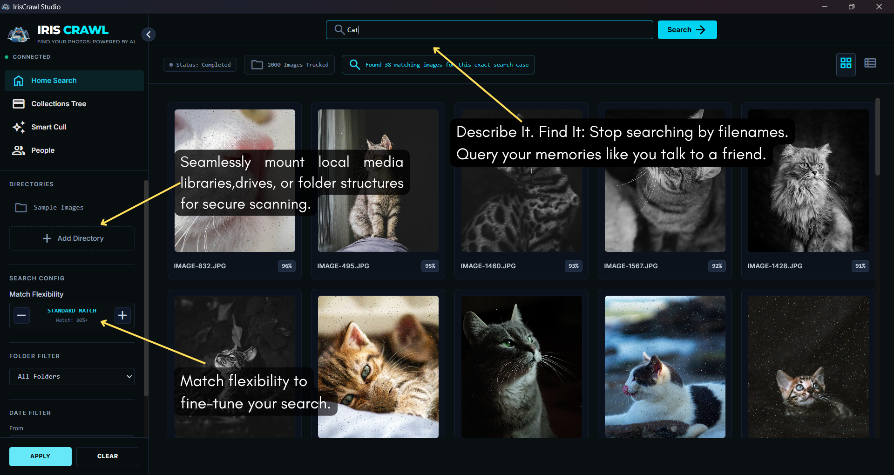
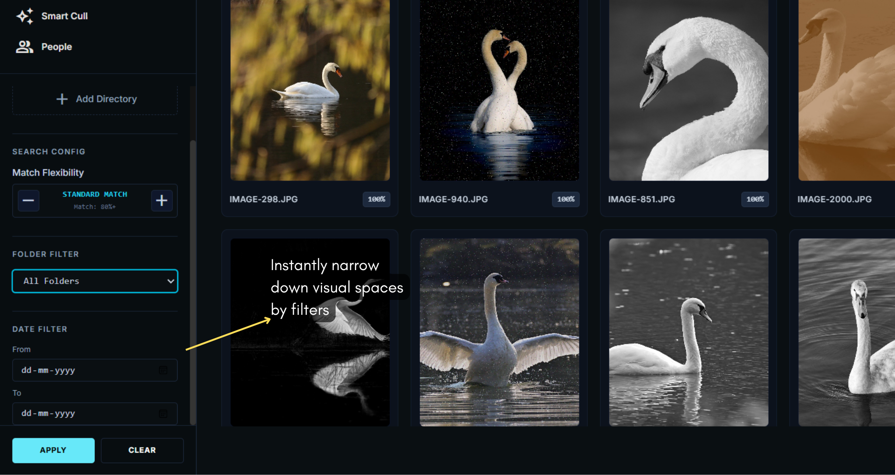
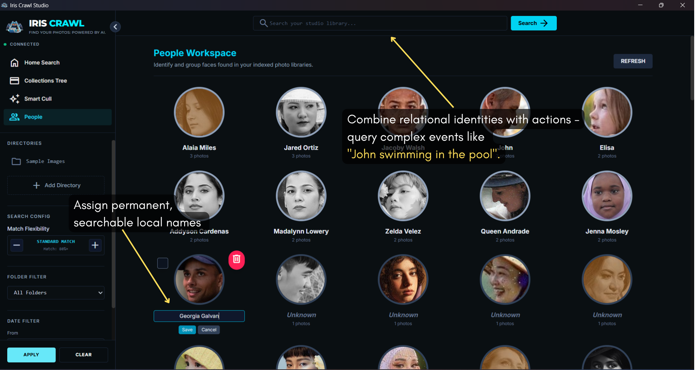

  
  <h1>IrisCrawl Studio</h1>
  
<em>Find Your Photos: Powered by AI.</em>

  <!-- GitHub Release Badges -->
  
  
   
  

 

Welcome to **IrisCrawl Studio**—a powerful **privacy-first image crawler** and **desktop asset manager** designed to fundamentally change how you interact with your digital memories. Built entirely for your local machine, IrisCrawl acts as an **offline semantic image search** engine, allowing you to find deeply buried photos using nothing but natural language.

Whether you're looking to consolidate decades of scattered photography, implement **high-speed facial recognition cataloging** for family albums, batch-cull duplicates, or index professional camera RAW files, IrisCrawl ensures your data never leaves your hard drive.

---

## 🏷️ Recommended GitHub Topics
`desktop-app`, `ai-photo-search`, `semantic-search`, `cross-platform`, `local-ai`, `privacy-first`, `face-recognition`, `photo-manager`, `qdrant`, `onnx-runtime`

---

## 🧠 Architectural Overview (v0.1.2)

IrisCrawl Studio achieves studio-grade performance by pairing a lightweight native desktop host with an embedded, hardware-aware neural pipeline:

1. **Native Desktop Shell**: Zero-dependency, instant native window lifecycle managed via Tauri/Rust, decoupling UI availability from heavy background engine cold starts.
2. **Two-Tier Adaptive Neural Engine**: Dynamically switches between **Iris Swift Vision™** (battery/low-spec optimized) and **Iris Studio Precision™** (deep multi-layer neural fidelity) based on live CPU, RAM, and power telemetry.
3. **Embedded On-Disk Vector Database**: Powered by an embedded **Qdrant** engine running disk-backed memory mapping (`mmap`). Even massive collections with tens of thousands of vectors consume negligible active RAM (< 50 MB).
4. **Single-Pass Facial Pyramid Pipeline**: Direct array memory parsing and batch transaction commits for facial embeddings, delivering up to 15× faster identity processing.
5. **Zero-Copy In-Memory Thumbnail Pipeline**: Single-pass 320px WebP thumbnail creation and direct embedded preview frame extraction for professional camera RAW formats (`.CR2`, `.CR3`, `.NEF`, `.ARW`, etc.) in ~5 ms.

---

## ⚡ Core Engine Features

| Feature | Description |
| --- | --- |
| 🗣️ **Natural Language Semantic Prompts** | Stop searching by file names. Search for descriptive phrases like *"dog running on a beach at sunset"* or *"red car in the snow"* and retrieve exact visual matches with calibrated match percentages. |
| 🎛️ **Two-Tier Hardware Adaptation** | Automatically switches between lightweight, battery-saving vision models and high-precision visual transformer profiles depending on available RAM, CPU cores, and power state. |
| 🗂️ **Single-Pass Lightning Face Recognition** | Detects, crops, and batches face embeddings in a single pass—indexing hundreds of portraits in seconds with automated profile clustering and merging. |
| ✨ **Smart Cull & Rapid Sharpness** | Real-time analysis polling calculates sharpness variance over cached thumbnails in < 1 ms, surfacing duplicate burst sequences and out-of-focus shots for one-click pruning. |
| 📷 **Accelerated HEIC & RAW Processing** | Bypasses slow 2-second sensor demosaicing on camera RAW files via instantaneous embedded preview extraction (~400× speedup) and zero redundant disk passes on HEIC files. |
| 🛡️ **Zero-Network Privacy Protocols** | 100% offline security. No cloud telemetry, no remote inference, and no external tracking. Built-in network isolation fallbacks prevent hangs in air-gapped environments. |

---

## 🚀 Step-by-Step User Runway

Ready to experience completely offline semantic visual searching?

### 1. Download the Installer
Head over to the [GitHub Releases](https://github.com/kolapraneeth22/iriscrawl-studio/releases/latest) page to grab the latest release payload.

- 📥 **[Download Latest Windows Executable (.exe)](https://github.com/kolapraneeth22/iriscrawl-studio/releases/download/v0.1.2/Iris.Crawl.Studio_0.1.2_x64-setup.exe)** — Standalone installer package (Recommended for standard single-user installations).
- 📥 **[Download Latest Windows Installer (.msi)](https://github.com/kolapraneeth22/iriscrawl-studio/releases/download/v0.1.2/Iris.Crawl.Studio_0.1.2_x64_en-US.msi)** — Windows Installer Package (Recommended for enterprise deployment and managed environments).

### 2. Run the Setup
Run the installer—it will cleanly configure or upgrade your installation without modifying existing indexed vector catalogs, face tags, or library pointers.

### 3. Launch the Studio
The native window loads immediately on startup. On your first boot or following an upgrade, the engine executes a brief background model verification. Once the status indicator turns green, mount your media directories and start searching.

---

## 📸 Interactive Application Interface Tour

Explore how IrisCrawl Studio maps, processes, and unlocks your local visual data completely offline. Click on a section below to expand the interface screens.

  
🗺️ 1. Onboarding & High-Speed Local Indexing (2 Screens)

   
  

    
     <em>Mount local media folders or drives securely.</em>  
    
     <em>Monitor background ingestion metrics, thread throughput, and batch commits in real time.</em>
  

  
🗣️ 2. Advanced Semantic Search & Parameter Calibration (2 Screens)

   
  

    
     <em>Query visual content using natural human language with calibrated similarity thresholds.</em>  
    
     <em>Narrow results down instantly by specific dates, confidence bands, or folder paths.</em>
  

  
🗂️ 3. Localized Facial Recognition Workspace (2 Screens)

   
  

    
     <em>Tag individual profiles and execute relational event queries safely on-disk.</em>  
    
     <em>Effortlessly merge matching facial profiles at scale with single-pass batch transactions.</em>
  

  
✨ 4. Storage Management & Asset Syncing (2 Screens)

   
  

    
     <em>Sync newly added media quickly without re-scanning unchanged catalog entries.</em>  
    
     <em>Detect burst sequences or duplicate assets with real-time progress indicators and instant sharpness scoring.</em>
  

---

## ⚙️ Minimum System Allocations

Thanks to **v0.1.2's Two-Tier Neural Engine** and **disk-backed memory mapping (`mmap`)**, IrisCrawl Studio now runs smoothly across both battery-constrained laptops and high-performance workstations.

| Requirement | Minimum (Swift Vision™ Tier) | Recommended (Studio Precision™ Tier) |
| --- | --- | --- |
| **Operating System** | Windows 10 x64 Architecture | Windows 11 x64 Architecture |
| **Processor (CPU)** | Intel Core i3 / AMD Ryzen 3 (Dual/Quad Core) | Intel Core i7 / AMD Ryzen 7+ (8+ Cores) |
| **Memory (RAM)** | 4 GB – 8 GB System RAM | 16 GB+ System RAM |
| **Active Vector RAM** | **< 50 MB** (Disk-mapped via Qdrant) | **< 150 MB** (Disk-mapped via Qdrant) |
| **Storage (Disk)** | 1 GB free space (Application, models & cache) | Fast NVMe SSD for high-throughput batch ingestion |
| **Supported Media** | JPEG, PNG, WebP, HEIC/HEIF | RAW Formats (`.CR2`, `.CR3`, `.NEF`, `.ARW`, etc.) |

---

## 💬 Feedback & Community

Your feedback drives the roadmap for IrisCrawl Studio!

- **Have an idea or question?** Open a thread on our [GitHub Discussions Board](https://github.com/kolapraneeth22/iriscrawl-studio/discussions).
- **Found a bug?** Submit a structured report through our [Issue Tracker](https://github.com/kolapraneeth22/iriscrawl-studio/issues/new/choose).

---

  
Built with ❤️ for privacy, efficiency, and precision.

